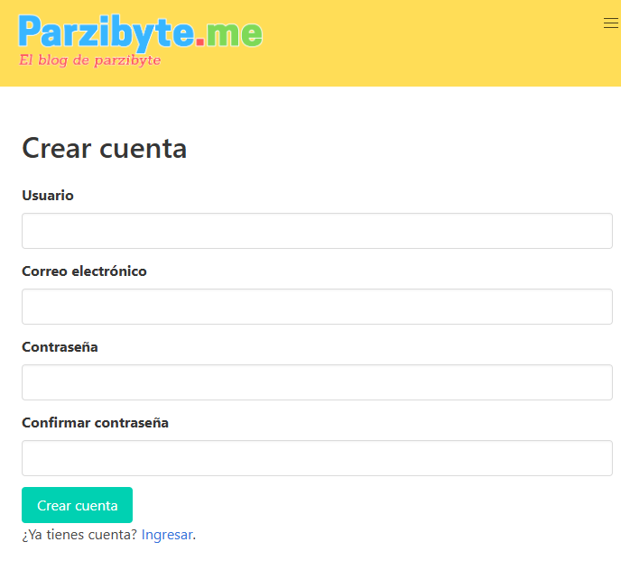
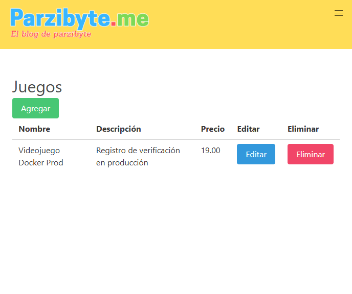

# Videojuegos: despliegue de producción

Aplicación Flask para administrar videojuegos, con registro e inicio de sesión, sesiones de usuario y persistencia en MySQL.

## Requisitos

- Docker Engine y Docker Compose v2 (`docker compose`).
- Puerto 80 disponible en el equipo.

## Configuración

1. Crea el archivo local de variables de entorno a partir de la plantilla:

   ```powershell
   Copy-Item .env.example .env
   ```

2. Edita `.env` y sustituye los valores de ejemplo por contraseñas seguras y una clave secreta aleatoria. La clave secreta puede generarse con:

   ```powershell
   python -c "import secrets; print(secrets.token_hex(32))"
   ```

   `MYSQL_PASSWORD` debe usar caracteres alfanuméricos para que la URL de conexión no requiera codificación adicional. `.env` no se versiona.

## Variables de entorno

| Variable | Uso |
| --- | --- |
| `MYSQL_ROOT_PASSWORD` | Contraseña administrativa de MySQL. |
| `MYSQL_USER` | Usuario de la aplicación en MySQL (por defecto, `user`). |
| `MYSQL_PASSWORD` | Contraseña del usuario de la aplicación. |
| `SECRET_KEY` | Clave persistente para firmar formularios y sesiones Flask. |
| `DATABASE_URL` | URL SQLAlchemy; Compose la construye como `mysql+pymysql://<usuario>:<contraseña>@db/videojuegos`. |
| `FLASK_ENV` | Compose la establece en `production`. |

No despliegues con las contraseñas de ejemplo. En producción, la aplicación falla al arrancar si falta `DATABASE_URL` o `SECRET_KEY`.

## Ejecutar en producción

Desde la raíz del proyecto, con `.env` configurado:

```powershell
docker compose up --build -d
docker compose ps
docker compose logs -f web
```

Compose espera a que el chequeo de salud de MySQL pase antes de iniciar Flask. El contenedor web crea las tablas iniciales y luego sirve la aplicación con Gunicorn en el puerto 8000, publicado como `http://localhost` en el puerto 80. Los datos de MySQL se conservan en el volumen `db_data`.

Abre <http://localhost>, regístrate en `/auth/register` e inicia sesión. Después podrás listar, crear, editar y eliminar videojuegos. Las sesiones de Flask-Login se firman con `SECRET_KEY` y funcionan entre procesos de Gunicorn porque la clave se mantiene estable.

Comandos de mantenimiento:

```powershell
docker compose down       # Detiene y elimina los contenedores
docker compose down -v    # También elimina los datos persistidos de MySQL
docker compose up --build -d
```

`docker compose down -v` elimina permanentemente la base de datos local. `db.create_all()` prepara tablas nuevas; para cambios posteriores de esquema, configura migraciones antes de actualizar la base de datos.

## Capturas

Capturas tomadas con la aplicación ejecutándose en Docker:

**Registro de usuario**



**Listado de videojuegos después de iniciar sesión**



Adjunta también estas imágenes a la entrega de Moodle **“Despliegue Producción Videojuegos”**.

## Pruebas

La suite automatizada usa SQLite y no requiere Docker ni MySQL:

```powershell
pytest
```
